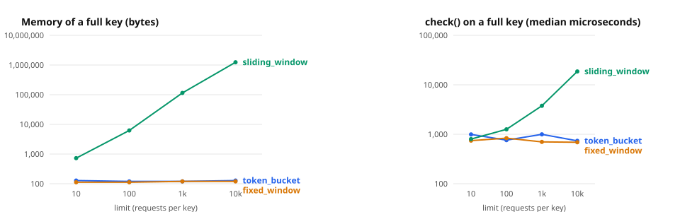

# Algorithm benchmarks

- measured: 2026-10-28 14:28
- machine: Windows-10-10.0.19045-SP0, Python 3.11.4
- redis: 7.4.11, 5000 calls per case

## Memory per key (bytes, Redis MEMORY USAGE)

A key whose limit is used up. The token bucket and the fixed window are one fixed-size value; the sliding window keeps one entry per request.

| algorithm | after 1 request | limit 10 full | limit 100 full | limit 1k full | limit 10k full |
|---|---:|---:|---:|---:|---:|
| token_bucket | 120 | 128 | 120 | 120 | 128 |
| fixed_window | 112 | 112 | 112 | 120 | 120 |
| sliding_window | 144 | 728 | 6,232 | 114,880 | 1,237,440 |

## Latency per check() call (microseconds, network included)

| algorithm | case | calls | p50 | p95 | p99 | max |
|---|---|---:|---:|---:|---:|---:|
| token_bucket | new key | 5000 | 992 | 1577 | 2410 | 13550 |
| token_bucket | full key, limit 10 | 5000 | 993 | 1427 | 1930 | 18312 |
| token_bucket | full key, limit 100 | 5000 | 762 | 1219 | 1628 | 5294 |
| token_bucket | full key, limit 1k | 5000 | 997 | 1937 | 2396 | 5542 |
| token_bucket | full key, limit 10k | 5000 | 737 | 1072 | 1510 | 10551 |
| fixed_window | new key | 5000 | 1066 | 1897 | 2213 | 6671 |
| fixed_window | full key, limit 10 | 5000 | 744 | 1071 | 1593 | 4333 |
| fixed_window | full key, limit 100 | 5000 | 834 | 1023 | 1217 | 2707 |
| fixed_window | full key, limit 1k | 5000 | 702 | 1109 | 1696 | 6719 |
| fixed_window | full key, limit 10k | 5000 | 689 | 992 | 1132 | 4221 |
| sliding_window | new key | 5000 | 741 | 1007 | 1330 | 4731 |
| sliding_window | full key, limit 10 | 5000 | 800 | 1150 | 1600 | 5051 |
| sliding_window | full key, limit 100 | 5000 | 1260 | 2537 | 3221 | 11855 |
| sliding_window | full key, limit 1k | 5000 | 3762 | 5877 | 7209 | 18560 |
| sliding_window | full key, limit 10k | 5000 | 18640 | 38532 | 46375 | 121045 |
